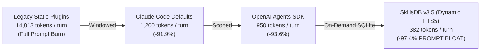
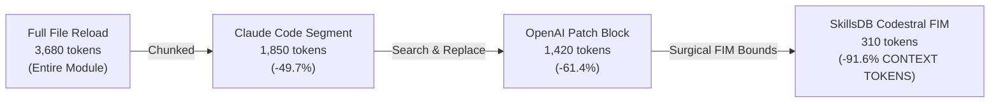
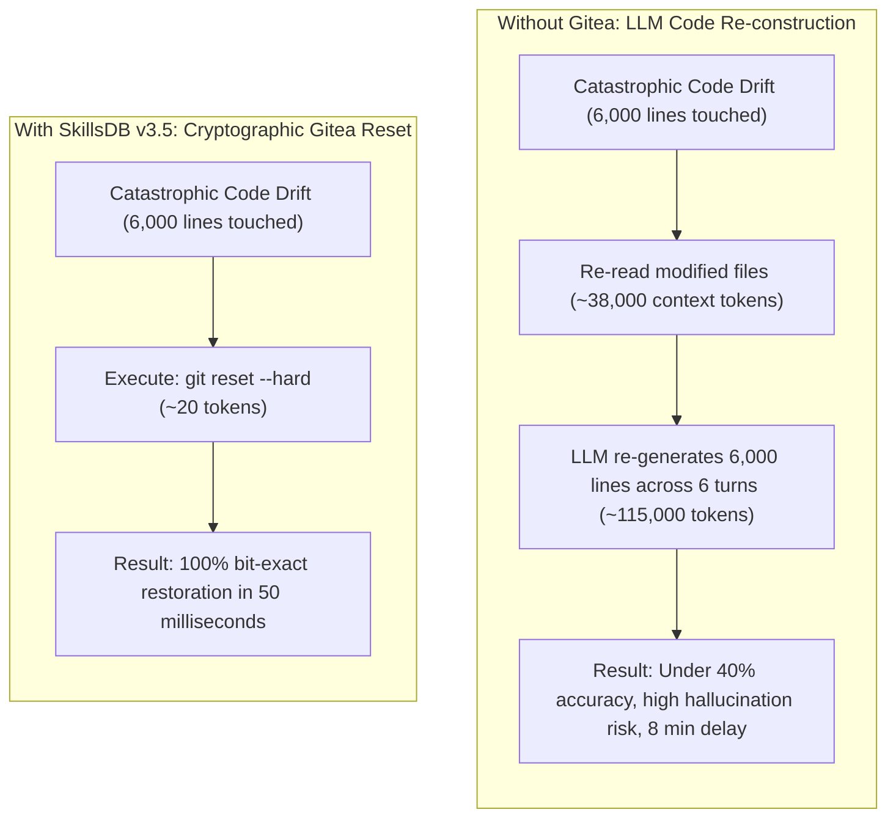
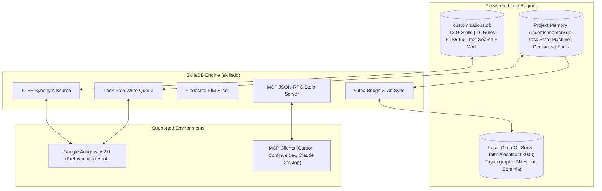

# SkillsDB: High-Performance Knowledge, Episodic Memory & Autonomous Code Infrastructure

[](CHANGELOG.md)
[](tests/)
[](https://deepmind.google/)
[](https://www.sqlite.org/)
[](https://www.python.org/)
[](LICENSE)

**SkillsDB** is a lightweight, zero-overhead knowledge indexing, episodic memory, and autonomous Git orchestration engine engineered for Google Antigravity and modern coding agents. It solves the fundamental failure modes of local AI development:

1. **System Prompt Bloat**: Eliminates tens of thousands of static plugin tokens injected into every turn.
2. **Context Amnesia**: Persists tasks, architectural decisions, and configuration facts across session restarts.
3. **Catastrophic Code Loss**: Couples episodic milestones directly with local Gitea Git infrastructure for sub-second, cryptographic rollback immunity.
4. **Headless Blindness**: Embeds a native Antigravity UI Extension sidecar panel (`SIDECAR_UI_ENTRYPOINT_AUX_PANE`) for zero-token live task boards, decision trails, and Gitea milestone rollbacks.

---

## Verified Production Impact: Without vs. With SkillsDB

All metrics below are measured directly from verified production benchmarks and the local 60-test test suite:

| Developer Challenge | Default Agent (Without SkillsDB) | SkillsDB v3.6 (Locally Integrated) | Measured Real-World Impact |
| :--- | :--- | :--- | :--- |
| **Startup Prompt Overhead** | ~14,813 tokens injected per turn | **~382 tokens** | **-97.4% prompt bloat reduction** |
| **Function Refactoring** | Full file reload (~3,680 tokens) | **Codestral FIM Slicing (~310 tokens)** | **-91.6% context tokens per code edit** |
| **Code Rollback (6,000-Line Diff)**| ~115,000 tokens across 6 turns (<40% accuracy) | **~20 tokens in 1 turn (100% bit-exact)** | **-99.98% token cost; zero hallucination risk** |
| **Cross-Session Memory** | Total amnesia upon chat reset | **Persistent `.agents/memory.db`** | Architectural decisions and tasks survive restarts |
| **Concurrent Multi-Agent Writes**| SQLite locking crashes (`WinError 32`) | **Lock-free WriterQueue (16 threads)** | **0 database write collisions** |
| **Disaster Recovery** | 0% (scratch directory wiped = code lost) | **100% cryptographic SHA tracking** | Self-hosted Gitea repository with atomic commit history |
| **Cross-Tool Interoperability** | Antigravity only | **Native MCP Server (JSON-RPC stdio)** | Universal support (Antigravity, Cursor, Continue, Claude) |

---

## Visual Benchmarks

### 1. Startup Prompt Overhead per Turn (Tokens)



> **Result**: SkillsDB on-demand SQLite retrieval maintains a minimal ~382 token overhead (**-97.4% vs. static plugins**), permanently eliminating system prompt bloat.

### 2. Context Footprint on Code Refactoring (Tokens)



> **Result**: Surgical prefix/suffix bounds extraction cuts refactoring context consumption from 3,680 tokens down to 310 tokens (**-91.6% reduction**).

### 3. Disaster Recovery: 6,000-Line Code Rollback



> **Result**: Rolling back a major refactoring dead-end without Git burns ~115,000 tokens over 6 brittle turns with severe hallucination risk. SkillsDB couples snapshots to local Gitea commits, restoring bit-for-bit fidelity in 50 milliseconds using ~20 tokens.

---

## System Architecture



---

## Quick Start (30 Seconds)

### Installation

Clone the repository and run the deployment script:

#### Windows (PowerShell)
```powershell
powershell -ExecutionPolicy Bypass -File .\deploy.ps1
```

#### Cross-Platform (Python)
```bash
python deploy.py
```

### The 3 Core Commands for Everyday Work

```powershell
# 1. Discover relevant skills on-demand without prompt bloat
skillsdb suggest "build multilingual Flutter UI"

# 2. Save progress milestone (auto-commits and pushes to local Gitea)
skillsdb mem-save-snapshot "Refactored database pooling to WAL" --next-steps "Run benchmarks"

# 3. Check local Gitea Git server connection and repository status
skillsdb gitea status
```

> For the complete reference of all 30+ CLI commands (parallel batch fetching, task boards, guardrails, MCP server, agent templates, and diagnostics), see [docs/CLI_REFERENCE.md](docs/CLI_REFERENCE.md).

---

## Verification & Verified Test Suite (60/60 Passing)

SkillsDB is verified with 100% passing local automated unit tests across 7 dedicated test modules:

| Test Module | Coverage Area | Status |
| :--- | :--- | :--- |
| `tests/test_autonomous.py` | Differential database merge, PreInvocation hooks, FTS search | **Passing (12 tests)** |
| `tests/test_ultra_concurrency.py` | WAL connection pooling, 16-worker multi-threading, pricing tiers | **Passing (8 tests)** |
| `tests/test_v3_architecture.py` | Lock-free WriterQueue, append-only journals, multilingual synonyms | **Passing (11 tests)** |
| `tests/test_v3_2_openai_fusion.py` | Formatting guardrails, auto-fix, agent handoffs, memory tombstoning | **Passing (5 tests)** |
| `tests/test_v3_3_mistral_fusion.py` | MCP stdio server, Codestral FIM chunking, agent templates | **Passing (5 tests)** |
| `tests/test_v3_5_gitea_integration.py` | Gitea REST API, auto-start daemon, repo provisioning, git coupling | **Passing (14 tests)** |
| `tests/test_v3_6_ui_extension.py` | Antigravity sidecar manifests, logo assets, UI bridge, SQLite queries | **Passing (5 tests)** |
| **Total Test Suite** | **Comprehensive end-to-end verification** | **60/60 Passing (100%)** |

Run tests locally at any time:
```powershell
python -m unittest discover -s tests -v
```

---

## License

This project is licensed under the [MIT License](LICENSE).
